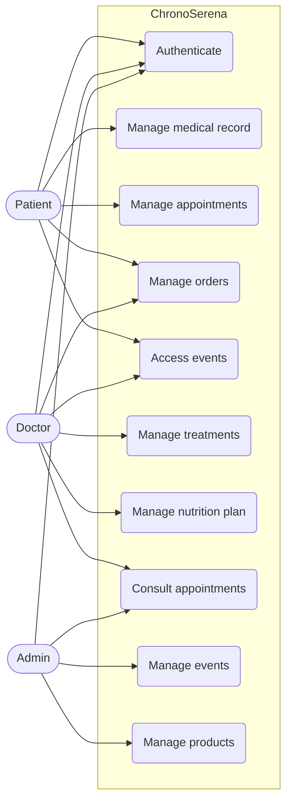
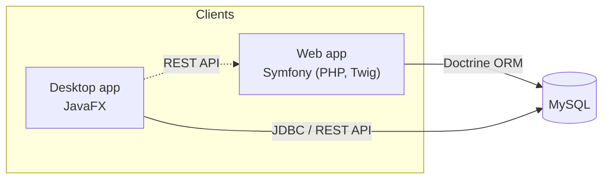
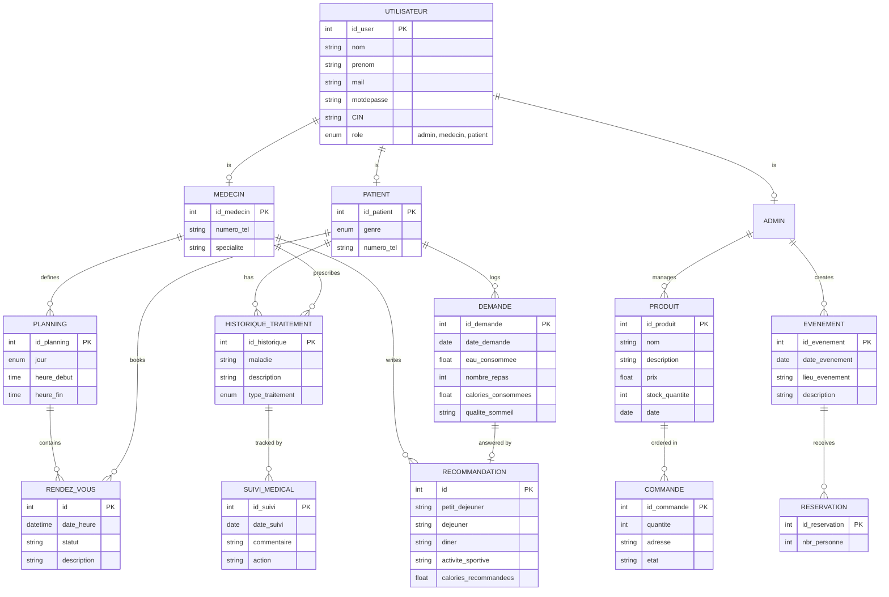

# 🏥 ChronoSerena

> **Prenez soin de vous, chez nous.**
> A distributed medical platform for chronic disease management: a **Symfony web app** and a **JavaFX desktop app** sharing the same data.

`2024–2025` · Team **eSanté Builders**

  

## 1. Overview

Chronic diseases require constant follow-up and rigorous care organization. Existing tools (Doctolib, Ameli.fr, MyChart) offer appointments or medical data, but lack modules dedicated to chronic patients and are often not intuitive.

**ChronoSerena** centralizes everything in one place:

- **Personalized access**: each patient has an account with their medical history and treatments
- **Centralized information**: treatments, appointments, events and orders in a single platform
- **Simplified interaction**: intuitive appointment planning and direct patient–doctor follow-up

Aligned with **SDG 3: Good Health and Well-being**.

## 2. Actors

| Actor | Capabilities |
|---|---|
| **Patient** | Manage medical record, book and manage appointments, order products, log lifestyle habits, join events |
| **Doctor** | Manage treatments and medical follow-up, manage planning and appointments, create nutrition/lifestyle recommendations, manage orders, join events |
| **Admin** | Manage users, products, orders and awareness events, view appointments |



## 3. Modules

| Module | Description |
|---|---|
| **User management** | Registration, authentication, profiles for patients, doctors and admins |
| **Treatment management** | Treatment history and medical follow-up (`Historique_Traitements`, `Suivi_Médical`) |
| **Appointment management** | Doctor schedules and patient bookings (`Rendez-vous`, `Planning`) |
| **Product management** | Medical equipment catalog and orders (`Produit`, `Commande`) |
| **Lifestyle management** | Daily habits logged by patients, personalized recommendations by doctors (`Demande`, `Recommandation`) |
| **Event management** | Awareness events and reservations (`Evenement`, `Reservation`) |

## 4. Architecture



Design choices: **MVC** architecture, **REST API**, **Singleton** pattern (database connection), reactive forms with data validation.

> Adjust the arrows above if the desktop app talks to the database directly (JDBC) or only through the Symfony REST API.

## 5. Data model



## 6. Tech stack

| Area | Technologies |
|---|---|
| Web | Symfony, PHP, Twig, Doctrine ORM |
| Desktop | JavaFX (Java) |
| Database | MySQL |
| API | REST |
| Patterns | MVC, Singleton |
| Design | Bootstrap-based front-office (Medicio) and back-office (NiceAdmin) templates |

## 7. Project structure

```
.
├── WEB/       # Symfony web application (front-office + back-office)
└── JAVAFX/    # JavaFX desktop application
```

## 8. Getting started

### Prerequisites

- PHP 8.1+, Composer, Symfony CLI
- JDK 17+ and JavaFX SDK (or Maven/Gradle)
- MySQL 8 (or XAMPP)
- Node.js (only if front-end assets need building)

### Database

```sql
CREATE DATABASE chronoserena CHARACTER SET utf8mb4;
```

### Web (Symfony)

```bash
cd WEB
composer install
cp .env .env.local        # then set DATABASE_URL="mysql://root:@127.0.0.1:3306/chronoserena"
php bin/console doctrine:database:create --if-not-exists
php bin/console doctrine:migrations:migrate
symfony server:start      # http://127.0.0.1:8000
```

### Desktop (JavaFX)

```bash
cd JAVAFX
# 1. Set the DB connection (URL, user, password) in the connection class / config file
# 2. Run from your IDE (IntelliJ / Eclipse) or with Maven:
mvn clean javafx:run
```

> Start MySQL first. Both apps must point to the **same** `chronoserena` database.

## 9. Graphic charter

Logo: heart + hands, tagline *"Prenez soin de vous, chez nous"*.
Main colors: steel blue `#3A8ABA`, azure `#007FFF`, aquamarine `#79F8F8`, denim `#1560BD`, cobalt `#22427C`.

## 10. Git workflow

```bash
git checkout -b your-name/feature-name
git checkout main && git pull origin main
git checkout your-name/feature-name && git merge main
git add . && git commit -m "your commit message"
git push -u origin your-name/feature-name
```

- Never work directly on `main`
- One branch per feature, clear commit messages
- Open a Pull Request on GitHub when done
